<div align="center">

# Arqui1 · Laboratorio de .NET 10

**Las prácticas de un curso de arquitectura de software con C#, convertidas en un hub interactivo con un tutor de IA.**


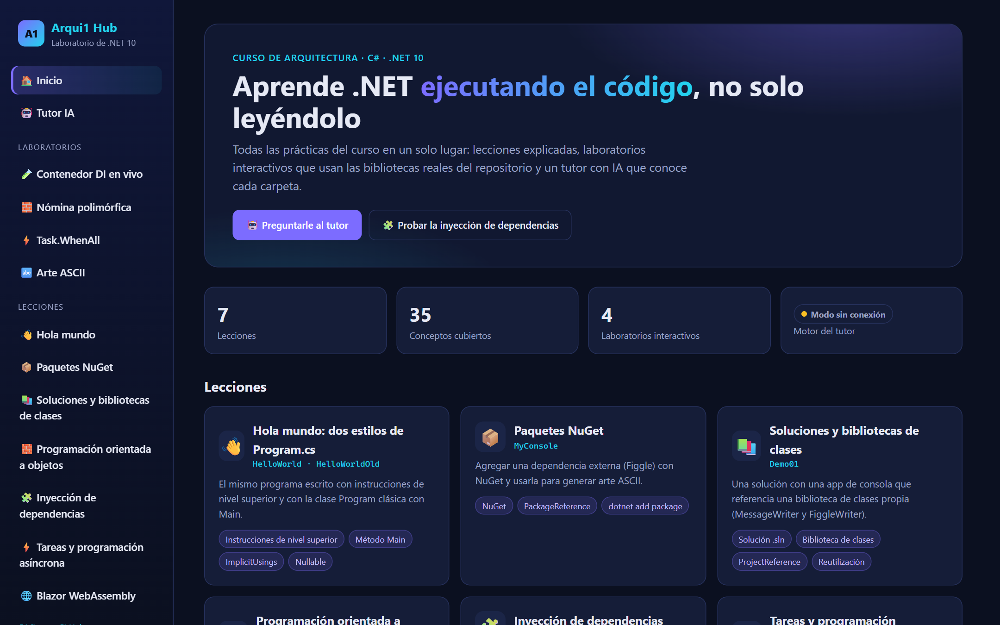

</div>

## Qué hay aquí

El repositorio empezó como la carpeta de prácticas del curso: un proyecto por tema, escritos mientras avanzaban las clases. Ahora todos compilan con .NET 10 y además hay un **hub web** que los reúne:

- 📚 **7 lecciones** explicadas, con los puntos clave, el código y el comando para ejecutarlas.
- 🧪 **4 laboratorios interactivos** que usan las bibliotecas reales del repositorio, no copias: inyección de dependencias, polimorfismo, concurrencia con `Task.WhenAll` y arte ASCII.
- 🎯 **Autoevaluación** con 21 preguntas sobre el código real; cada fallo trae su explicación y un botón para preguntarle al tutor.
- 🤖 **Tutor IA** con Claude que conoce cada carpeta y su código. Sin API key funciona en modo sin conexión.

## Arranque rápido

Requisito: [SDK de .NET 10](https://dotnet.microsoft.com/download/dotnet/10.0).

```bash
git clone https://github.com/zemogc/Carpeta_Arqui1.git
cd Carpeta_Arqui1
dotnet build Arqui1.slnx
dotnet run --project Arqui1.Hub
```

Abre <http://localhost:5118>.

### Activar el Tutor IA (opcional)

Sin configuración, el tutor responde con el contenido de las lecciones. Para conversar con Claude, guarda tu API key de [Anthropic](https://platform.claude.com/) en los *user secrets* (quedan fuera del repositorio):

```bash
dotnet user-secrets set Anthropic:ApiKey "sk-ant-..." --project Arqui1.Hub
```

También sirve la variable de entorno `ANTHROPIC_API_KEY`. En `Arqui1.Hub/appsettings.json` puedes cambiar el modelo (`Tutor:Model`) y el modo (`Tutor:Mode`: `auto`, `claude` u `offline`).

## Capturas

### 🤖 Tutor IA

Pregunta lo que quieras del curso. Con Claude, la respuesta llega en streaming; en modo sin conexión, el tutor busca la lección más relacionada.

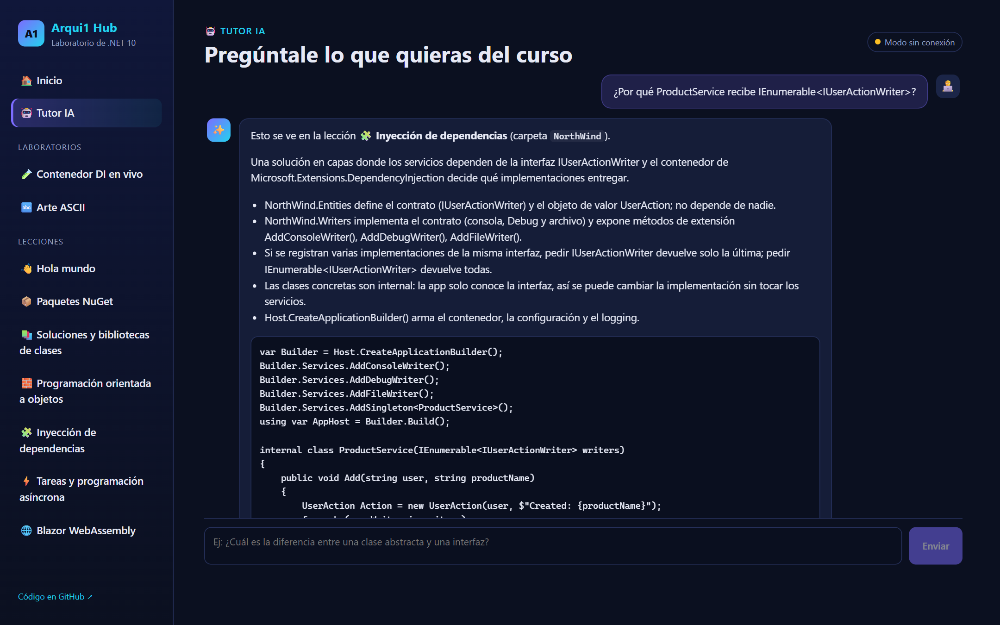

### 🎯 Autoevaluación

Siete preguntas por ronda, de todas las lecciones o de una sola. Las opciones se barajan en cada ronda, y cada fallo lleva un botón que manda tu respuesta al Tutor IA para que te lo explique de otra forma.

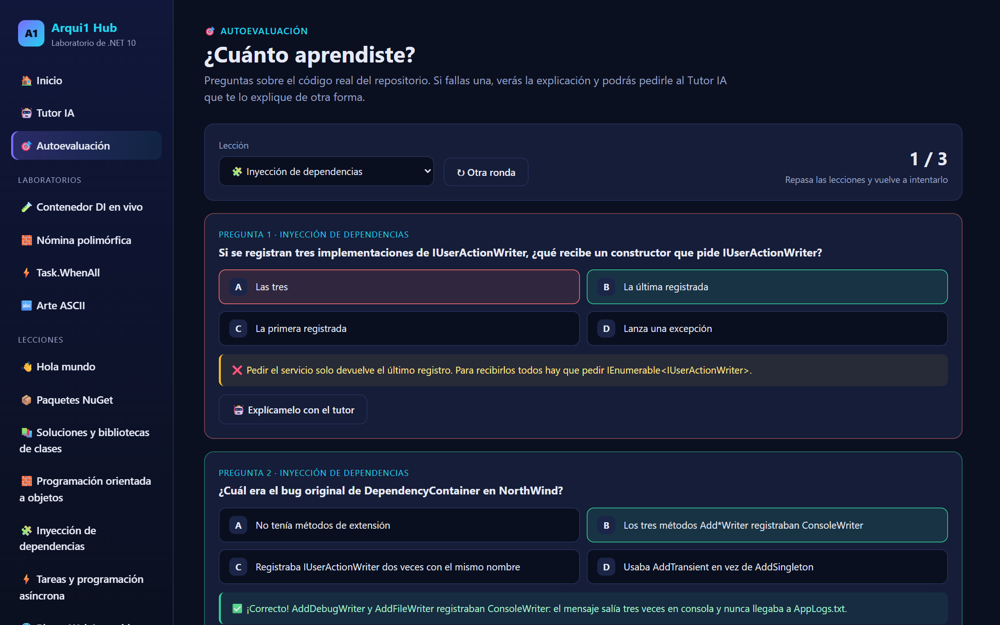

### 🧪 Contenedor DI en vivo

Elige qué `IUserActionWriter` registrar y mira a dónde llega cada mensaje. El laboratorio usa el contenedor real de `Microsoft.Extensions.DependencyInjection` con los contratos de `NorthWind.Entities`.

| Con el bug original | Corregido |
|---|---|
| 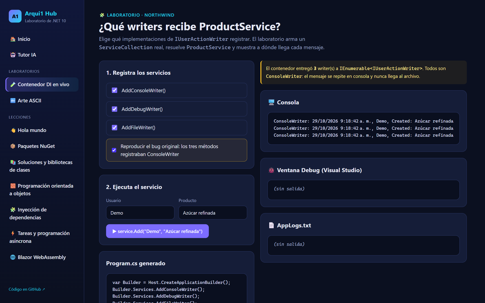 | 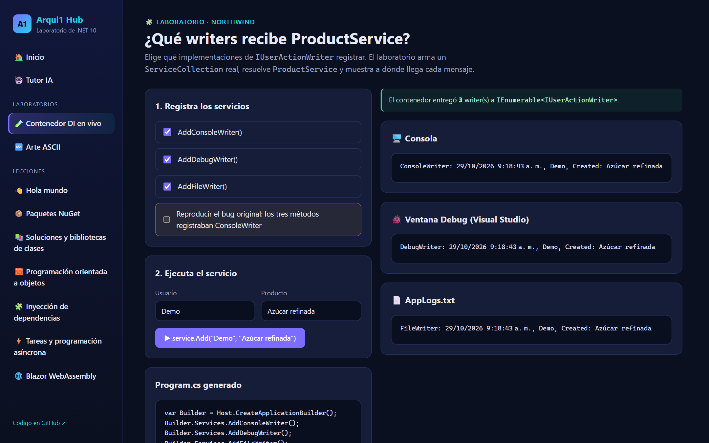 |

Con el bug, los tres `Add*Writer` registraban `ConsoleWriter`: el mensaje salía tres veces en consola y nunca llegaba al archivo.

### 🧱 Nómina polimórfica

Una `List<Employee>` con instancias reales de `Secretary`, `Manager` y `Developer` de `Demo02`. Contrata o despide empleados y mira cómo cada tipo calcula su pago con su propio `override`.

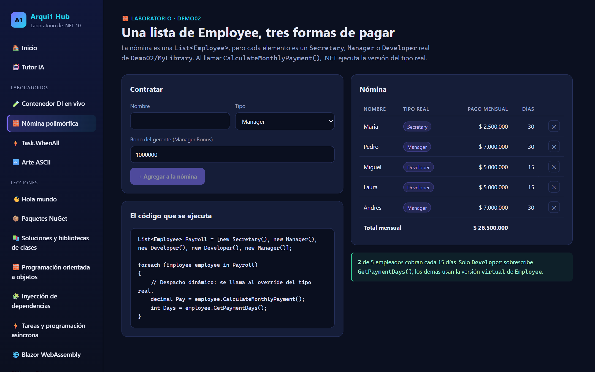

### ⚡ Secuencial vs. Task.WhenAll

Cinco operaciones de E/S simuladas, primero una tras otra y después todas a la vez. Las barras muestran en vivo cuándo arranca y termina cada una.

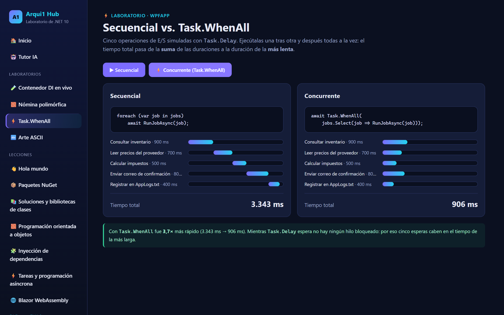

### 🔤 Arte ASCII

Reutiliza `FiggleWriter` de `Demo01/MyLibrary` mediante una referencia de proyecto: el mismo código que imprime en la consola, ahora en la web.

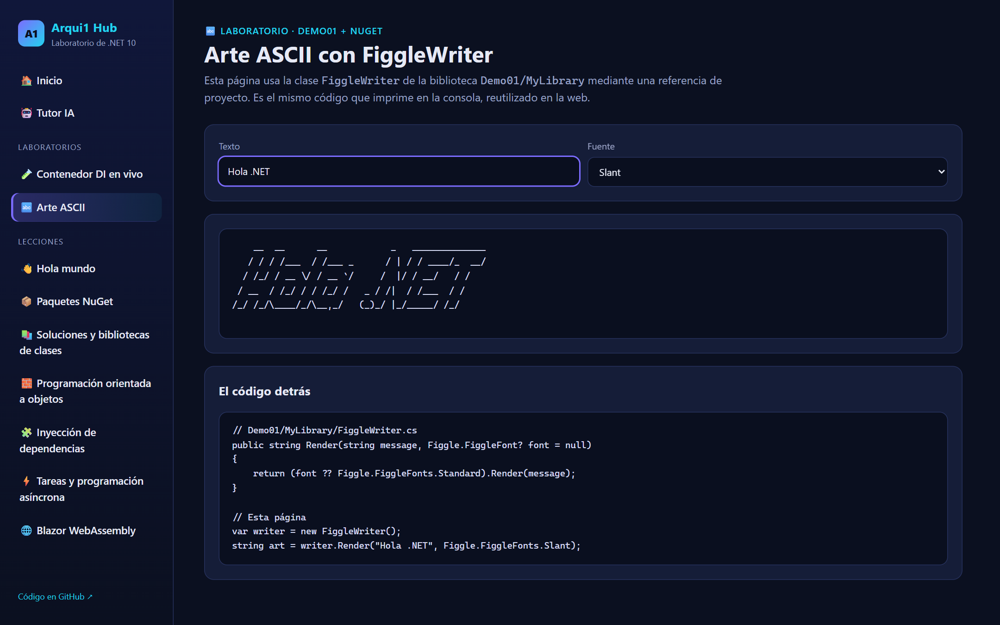

### 📖 Lecciones

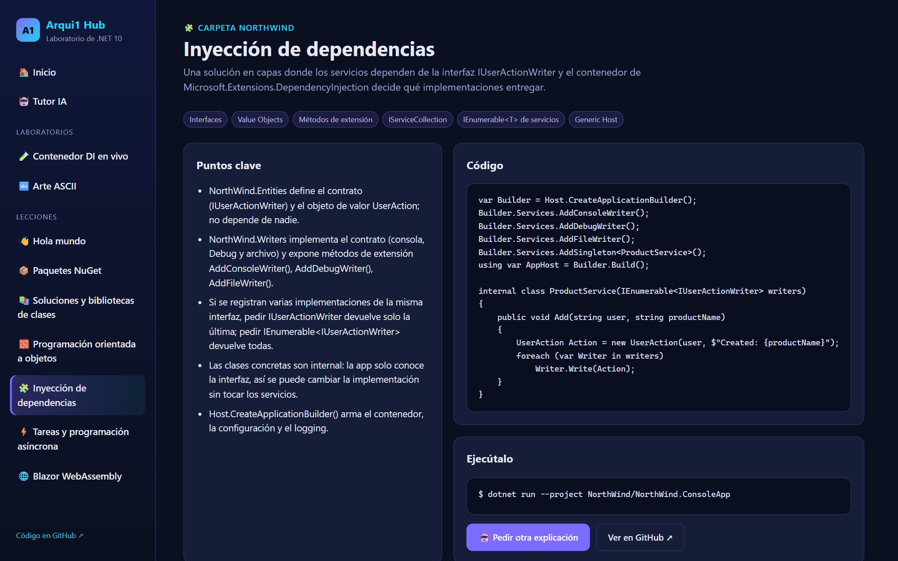

### ⚡ WPF: laboratorio de Tasks

Cuatro formas de crear tareas (delegado `Action`, método anónimo, lambda y `Task.Run` + `async/await`). Cada línea indica en qué hilo corrió.

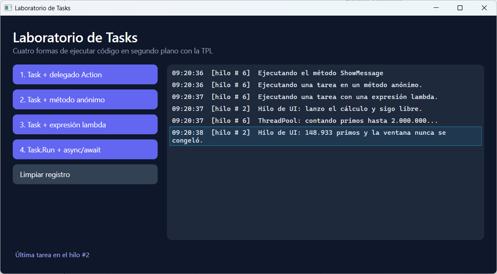

### 🖥️ Apps de consola

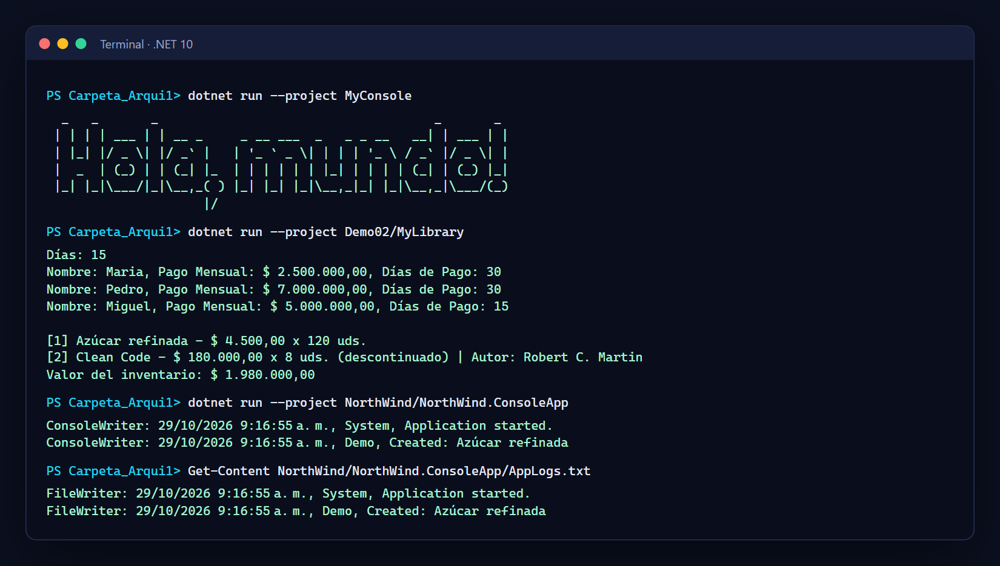

## Lecciones

| Carpeta | Tema | Conceptos | Ejecutar |
|---|---|---|---|
| [`HelloWorld`](HelloWorld) · [`HelloWorldOld`](HelloWorldOld) | Dos estilos de `Program.cs` | Instrucciones de nivel superior, `Main`, `ImplicitUsings` | `dotnet run --project HelloWorld` |
| [`MyConsole`](MyConsole) | Paquetes NuGet | `PackageReference`, Figgle | `dotnet run --project MyConsole` |
| [`Demo01`](Demo01) | Soluciones y bibliotecas | Biblioteca de clases, `ProjectReference` | `dotnet run --project Demo01/MyConsoleApp` |
| [`Demo02`](Demo02) | Programación orientada a objetos | Constructores primarios, herencia, clases abstractas, polimorfismo | `dotnet run --project Demo02/MyLibrary` |
| [`NorthWind`](NorthWind) | Inyección de dependencias | Interfaces, value objects, métodos de extensión, Generic Host | `dotnet run --project NorthWind/NorthWind.ConsoleApp` |
| [`WPFApp`](WPFApp) | Tareas y asincronía | `Task`, delegados, lambdas, `async/await`, `Dispatcher` | `dotnet run --project WPFApp/WPFApp` (Windows) |
| [`LabScript`](LabScript) | Blazor WebAssembly | Componentes Razor, `@code`, `@onclick`, `HttpClient` | `dotnet run --project LabScript/LabScript` |
| [`Arqui1.Hub`](Arqui1.Hub) | El hub de este README | Blazor Interactive Server, IA con Claude | `dotnet run --project Arqui1.Hub` |

## Cómo está hecho el hub

```
Arqui1.Hub/
├── Data/
│   ├── LessonCatalog.cs           Las lecciones. Alimentan las páginas y el prompt del tutor
│   └── QuizBank.cs                Preguntas de la autoevaluación
├── Services/
│   ├── DependencyLab.cs           ServiceCollection real con los contratos de NorthWind.Entities
│   ├── ConcurrencyLab.cs          Ejecución secuencial vs. Task.WhenAll con tiempos medidos
│   └── Tutor/
│       ├── ITutorService.cs       Contrato común: respuesta por fragmentos (IAsyncEnumerable)
│       ├── ClaudeTutorService.cs  SDK oficial de Anthropic, streaming
│       ├── OfflineTutorService.cs Búsqueda por palabras clave en las lecciones
│       └── TutorPrompt.cs         Prompt de sistema generado desde el catálogo
└── Components/Pages/              Inicio, lección, laboratorios y tutor
```

El tutor es otro ejemplo de inyección de dependencias: `Program.cs` registra `ClaudeTutorService` si hay credenciales y `OfflineTutorService` si no, y la página solo conoce `ITutorService`.

Detalles del tutor con Claude:

- Modelo `claude-opus-5-5`, esfuerzo `medium` y respuesta en streaming.
- El prompt de sistema es estable entre peticiones y lleva `cache_control` para aprovechar la caché de prompts.
- Fallback del lado del servidor (`fallbacks: "default"`): si un clasificador rechaza la petición, la API la reintenta en el modelo recomendado.
- El Markdown de la respuesta se renderiza con Markdig sin permitir HTML crudo.

## Pruebas

```bash
dotnet test Arqui1.Hub.Tests
```

29 pruebas con xUnit. Entre ellas, la petición que el tutor envía a la API se verifica con un `HttpMessageHandler` falso (modelo, streaming, fallbacks, historial y prompt), así que se prueba sin gastar créditos.

## Estructura del repositorio

```
Arqui1.slnx         Solución con todos los proyectos
global.json         Fija el SDK de .NET 10
Arqui1.Hub/         Hub web + Tutor IA
Arqui1.Hub.Tests/   Pruebas del hub
Demo01/  Demo02/  HelloWorld/  HelloWorldOld/  LabScript/  MyConsole/  NorthWind/  WPFApp/
docs/capturas/      Imágenes de este README
```
